# AeroGuard

[](https://github.com/RayenSansa03/aeroguard/actions/workflows/ci.yml)
[](https://github.com/RayenSansa03/aeroguard/actions/workflows/cd.yml)
[](https://github.com/RayenSansa03/aeroguard/releases)
[](https://codecov.io/gh/RayenSansa03/aeroguard)
[](https://github.com/astral-sh/ruff)

[](https://github.com/RayenSansa03/aeroguard/network/updates)

**Detect aircraft engine wear early, recognize failures never seen in training, and tell the maintenance team what to do.**

AeroGuard is an end-to-end anomaly detection system built on NASA N-CMAPSS turbofan data: a GPU-accelerated feature pipeline (NVIDIA RAPIDS), a hybrid of XGBoost and an autoencoder, a decision engine, a FastAPI service with ONNX or NVIDIA Triton inference, a Streamlit dashboard, CI/CD and drift monitoring.

**▶ Live API:** <https://aeroguard-api-75tq.onrender.com/docs> (free hosting: the first request may take about a minute while the service wakes up)

### Key results (39 test engines, never seen in training)

| What                                           | Result                                                                    |
| ---------------------------------------------- | ------------------------------------------------------------------------- |
| Known failures warned before breakdown         | **39 / 39** engines, about **40 flights** in advance                      |
| Never-seen failure (fan removed from training) | hybrid system **4 / 4** engines, versus 2 / 4 for XGBoost alone           |
| Fleet replay through the API                   | **39 failures avoided**, **0** in-service failures                        |
| GPU speed-up                                   | cuDF up to **×19.5**, XGBoost training **×4.3**                           |
| API                                            | ONNX mode ≈ **5 ms** median latency, **76 / 76** parity with the notebook |
| Quality                                        | **351** automated tests, CI/CD on every tag                               |

### Architecture

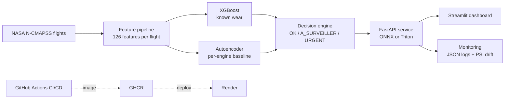

> **Note on figures:** the figures come from the original lab notebooks, so their labels are in French. Each figure is followed by a short "How to read this figure" note explaining the axes, colors and French labels.

**Sensor names used in the figures:** T = temperature (T24, T30, T48, T50), P = pressure (P2, P15, P21, P24, Ps30, P40, P50), Nf = fan speed, Nc = core speed, Wf = fuel flow. Feature suffixes: `_montee` = climb phase, `_croisiere` = cruise phase.

## Goals

- Detect the onset of a failure as early as possible
- Identify the affected component (fan, compressor, turbine)
- Spot failures never seen during training

## Overview

Each curve is one engine: the T48 temperature stays stable, then takes off in the last 30 to 40 flights before failure. AeroGuard's goal is to spot this take-off as early as possible.

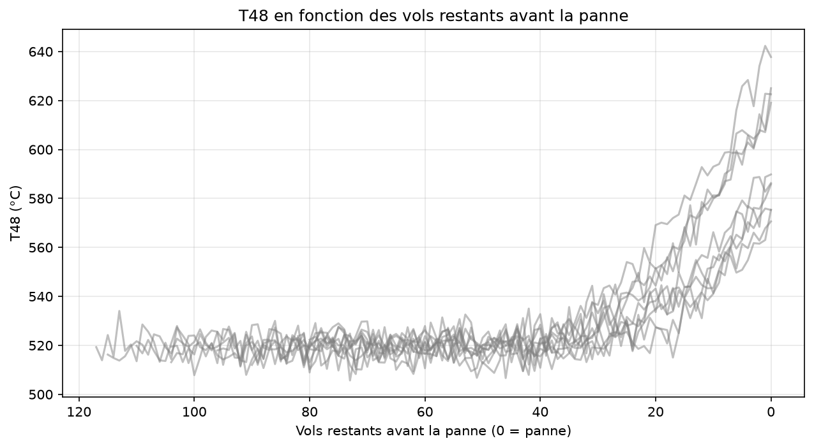

> **How to read this figure**
>
> - **X-axis:** flights remaining before failure (the RUL). The axis is reversed, so time moves from left to right and **0 = failure** is on the right. Label: _"Vols restants avant la panne (0 = panne)"_ = "Flights remaining before failure (0 = failure)".
> - **Y-axis:** T48 temperature in °C (gas temperature between the high-pressure and low-pressure turbines).
> - **Lines:** each gray line is one engine of the simulated fleet.
> - **Title:** _"T48 en fonction des vols restants avant la panne"_ = "T48 versus flights remaining before failure".

## First results: z-score baseline (simulated fleet)

"Normal" is learned on the healthy flights of 5 engines; detection is tested on 5 other engines, never seen before.

| z threshold | Mean detection delay | Mean alert lead time | False alarms |
| ----------- | -------------------- | -------------------- | ------------ |
| 2.5         | 11.4 flights         | 28.8 flights         | 3            |
| **3**       | **13.4 flights**     | **26.8 flights**     | **1**        |
| 4           | 18.8 flights         | 21.4 flights         | 0            |

This baseline is the reference: the next models (XGBoost, autoencoder) must detect wear earlier.

## ⚡ GPU acceleration (RAPIDS cuDF)

Data preparation of N-CMAPSS DS01 (4.9 million rows), NVIDIA T4 GPU (Google Colab):

| Task               | pandas (CPU) | cuDF (GPU) | Speed-up |
| ------------------ | ------------ | ---------- | -------- |
| Read parquet       | 1.954 s      | 0.413 s    | ×4.7     |
| Mean per flight    | 0.407 s      | 0.086 s    | ×4.7     |
| Features per phase | 2.065 s      | 0.106 s    | ×19.5    |

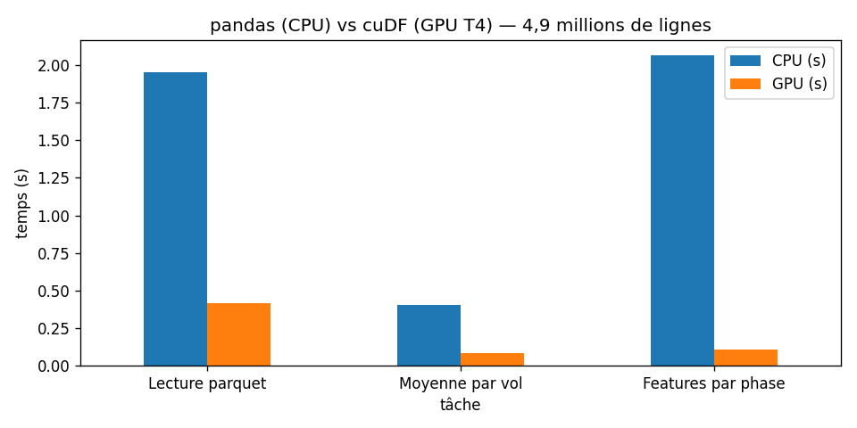

> **How to read this figure**
>
> - **X-axis:** the three data-preparation tasks. _"Lecture parquet"_ = "Read parquet", _"Moyenne par vol"_ = "Mean per flight", _"Features par phase"_ = "Features per phase".
> - **Y-axis:** execution time in seconds (_"temps (s)"_ = "time (s)"). **Lower is faster.**
> - **Bars:** blue = pandas on CPU, orange = cuDF on GPU.
> - **Title:** _"pandas (CPU) vs cuDF (GPU T4) — 4,9 millions de lignes"_ = "… 4.9 million rows".

## ✈️ v1 — Full N-CMAPSS pipeline

- **9 NASA files** (DS01 to DS08c), **7 failure families** (11 detailed modes), **99 engines**, **7,473 flights**
- One row per flight: 126 features (residuals per flight phase) + labels (hs, RUL, failure mode and family)
- Split by engine: 49 train / 11 validation / 39 test, with no leakage, checked automatically
- 42 automated tests (pytest + GitHub Actions)
- DS08d excluded: truncated file in the official NASA archive (correct CRC, incomplete data)

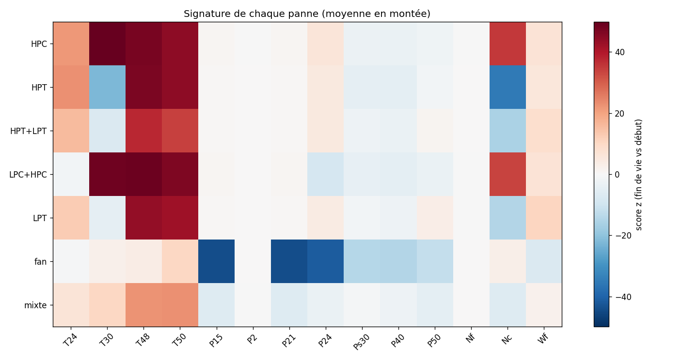

> **How to read this figure** (heatmap)
>
> - **X-axis (columns):** the 14 engine sensors, averaged over the climb phase.
> - **Y-axis (rows):** one row per failure family.
> - **Color:** how much each sensor changed at end of life compared with the start of life, as a z-score (mean of the last 10 flights before failure minus mean of the first 10 flights, divided by the standard deviation of the first 10). **Red = the sensor rises, blue = it drops, white = no change.** Color-bar label: _"score z (fin de vie vs début)"_ = "z-score (end of life vs start)".
> - **Title:** _"Signature de chaque panne (moyenne en montée)"_ = "Signature of each failure (mean during climb)".

**What the signatures show:** damaged compressors → T30 and Nc rise; damaged turbines → T48/T50 rise and Nc drops; damaged fan → pressures P15, P21 and P24 drop.

## 🤖 v2 — Machine learning and metrics

Six models compared on **11 validation engines never seen during training** (819 flights). Main metric: **macro F1**, which judges healthy and worn flights fairly.

**Per flight**

| Model                           | Macro F1  | PR-AUC | Recall    | False alarms | Missed failures |
| ------------------------------- | --------- | ------ | --------- | ------------ | --------------- |
| **Logistic regression**         | **0.886** | 0.987  | 0.932     | 39           | 39              |
| Random Forest                   | 0.844     | 0.985  | **0.951** | 73           | **28**          |
| KNN                             | 0.763     | 0.903  | 0.843     | 75           | 90              |
| Isolation Forest (unsupervised) | 0.663     | 0.915  | 0.581     | 29           | 241             |
| Naive model (reference)         | 0.412     | 0.702  | 1.000     | 244          | 0               |

**Per engine** (what matters to an airline), alert confirmed over 3 consecutive flights

| Model                   | Engines warned | Mean lead time                | False alarms |
| ----------------------- | -------------- | ----------------------------- | ------------ |
| **Logistic regression** | **11 / 11**    | **46 flights before failure** | **9**        |
| Random Forest           | 11 / 11        | 48 flights                    | 31           |
| Isolation Forest        | 11 / 11        | 25 flights                    | 3            |

**Selected model:** logistic regression with 3-flight confirmation. It warns for every engine, about 46 flights before failure, with 3 times fewer false alarms than the Random Forest.

**What we learned:**

- A naive model reaches 70% accuracy without detecting anything: accuracy alone is misleading.
- The most important features (T48 and T50 during climb) match the physical signature of turbine wear.
- The unsupervised model (Isolation Forest) warns every engine, but late: this motivates the autoencoder (v5).

Details of all experiments: [`docs/baselines.md`](docs/baselines.md).

## ⚡ v3 — XGBoost on GPU

Final evaluation, run only once, on **39 test engines never seen before** (settings frozen on validation).

**"This engine is wearing out" alert** (alert confirmed over 3 flights)

| Model                                | Engines warned | Mean lead time                | False alarms       |
| ------------------------------------ | -------------- | ----------------------------- | ------------------ |
| Logistic regression (v2)             | 39 / 39        | 44.7 flights                  | 54 (12 engines)    |
| **XGBoost GPU, threshold 0.81 (v3)** | **39 / 39**    | **40 flights before failure** | **28 (4 engines)** |

**"Which component?" diagnosis** (7 failure families): 37 engines out of 39 correctly diagnosed by XGBoost, 35 / 39 by the logistic regression.

**Facing a never-seen failure** (one family removed from training):

- the alert still detects every engine for 6 families out of 7, but becomes almost blind to a fan failure (2 engines out of 4 warned);
- the diagnosis is then wrong with ~90% confidence: a supervised model cannot say "unknown". This motivates the autoencoder (v5).

**Speed**: on 371,600 flights, XGBoost training is **4.3 times faster on GPU** (12 s versus 53 s on CPU).

## 🧠 v4 — Deep learning (TensorFlow): dense network and 1D CNN

Final evaluation on the **39 test engines** (settings frozen on validation), with a 95% confidence interval obtained by **bootstrapping over engines** (1,000 randomly drawn fleets).

| Model                                  | Macro F1 [95% CI]     | Engines warned | Mean lead time | False alarms       | Prediction (2,938 flights) |
| -------------------------------------- | --------------------- | -------------- | -------------- | ------------------ | -------------------------- |
| **XGBoost (v3)**                       | **0.852** [0.83–0.87] | **39 / 39**    | 40.1 flights   | **28 (4 engines)** | 0.02 s                     |
| Logistic regression                    | 0.840 [0.81–0.86]     | 39 / 39        | 44.7 flights   | 54 (12 engines)    | 0.007 s                    |
| Dense network (10,241 weights)         | 0.823 [0.80–0.85]     | 39 / 39        | 41.3 flights   | 51 (11 engines)    | 0.08 s                     |
| 1D CNN on raw signals (47,265 weights) | 0.743 [0.68–0.80]     | 37 / 39        | 32.0 flights   | 35 (6 engines)     | 3.1 s                      |

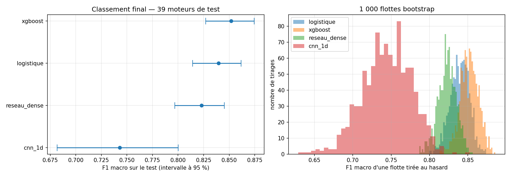

> **How to read this figure** (two panels)
>
> - **Left panel:** the **X-axis** is the macro F1 on the test set; the **Y-axis** lists the models, from worst at the bottom to best at the top. Each dot is the score and each horizontal bar is its 95% confidence interval. Label: _"F1 macro sur le test (intervalle à 95 %)"_ = "Macro F1 on the test set (95% interval)". Model names: _logistique_ = logistic regression, _reseau_dense_ = dense network. Title: _"Classement final — 39 moteurs de test"_ = "Final ranking — 39 test engines".
> - **Right panel:** the **X-axis** is the macro F1 of one randomly drawn fleet (_"F1 macro d'une flotte tirée au hasard"_); the **Y-axis** is the number of draws (_"nombre de tirages"_). One colored histogram per model. **Overlapping histograms = the difference between the two models is not proven.** Title: _"1 000 flottes bootstrap"_ = "1,000 bootstrap fleets".

- **XGBoost remains the alert model.** The gap with the logistic regression is not proven (−0.013, interval [−0.038; +0.011]); XGBoost is kept because it halves the false alarms.
- The dense network and the CNN are **significantly** behind XGBoost (gaps of −0.029 and −0.108, with intervals that exclude 0).
- The CNN, which only sees the raw signal, **matches XGBoost on turbine failures** (HPT+LPT: 0.867 versus 0.857) but **fails on the fan** (0.288 versus 0.777): the fan signature is a small pressure variation, drowned in the flight conditions.
- Lesson: with 49 training engines, good physical features beat deep learning. Next ideas: more windows per flight, residuals as inputs.

## 🗂️ MLOps: MLflow model registry

The production alert model is registered in the **MLflow registry** under the name `aeroguard-alerte`, and loaded by its alias, never by a file name:

```python
modele = mlflow.xgboost.load_model("models:/aeroguard-alerte@champion")
```

| Version | Alias         | Model               | Threshold | Test macro F1 [95% CI] |
| ------- | ------------- | ------------------- | --------- | ---------------------- |
| 2       | **@champion** | XGBoost (v3)        | 0.81      | 0.852 [0.827; 0.874]   |
| 1       | @challenger   | Logistic regression | 0.50      | 0.840 [0.814; 0.862]   |

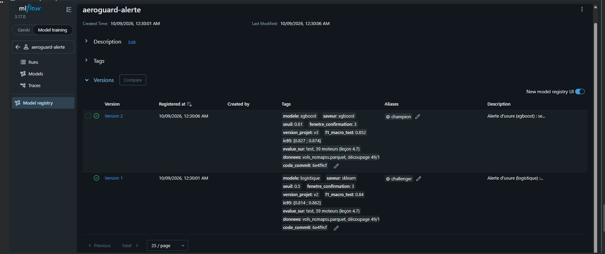

> **How to read this figure** (screenshot, no axes)
>
> - Screenshot of the MLflow user interface for the registered model `aeroguard-alerte`.
> - Each row is one model **version**; the **Aliases** column shows which version is `@champion` (used in production) and which is `@challenger`.

- Each version carries its **model card**: threshold, 3-flight confirmation, test score and confidence interval, data and code commit (traceability).
- **Smoke test**: the champion reloaded from the registry gives exactly F1 = 0.852 on the test set again.
- **Promotion rule**: a challenger only becomes champion if it beats the champion in a proven way (bootstrap by engine). Promotion and rollback only move an alias: the code never changes.

## 🛡️ v5 — Autoencoder and hybrid system: detecting never-seen failures

A supervised model only recognizes the failures it has learned: without any fan engine in training, XGBoost warns only **2 fan test engines out of 4**. Version 5 adds an **autoencoder** trained only on **healthy** flights: anything it reconstructs badly is suspicious, whatever the failure.

- **Per-engine baseline**: each flight is compared with the first 10 flights of **its own** engine, which removes the fleet signature (without it, the autoencoder was constantly alarming on a never-seen fleet).
- **Hybrid system**: alert if XGBoost **or** the autoencoder alerts; displayed states are "normal", "unknown anomaly", "known wear", "confirmed wear".
- **Per-sensor diagnosis**: the worst-reconstructed sensors guide the inspection (fan → P21, P15; HP turbine → T48; LP turbine → T50).

**Final evaluation on the 39 test engines** (settings frozen on validation, after the 10 baseline flights):

| System                 | Known failures: engines warned | Mean lead time   | False alarms | Never-seen family: engines warned    |
| ---------------------- | ------------------------------ | ---------------- | ------------ | ------------------------------------ |
| XGBoost v3 alone       | 39 / 39                        | 40.1 flights     | 26           | 37 / 39 (fan: **2 / 4**)             |
| Autoencoder + baseline | 39 / 39                        | 32.5 flights     | 7            | 39 / 39 (fan: 4 / 4, 0 false alarms) |
| **Hybrid (v5)**        | **39 / 39**                    | **40.8 flights** | 29           | **39 / 39 (fan: 4 / 4)**             |

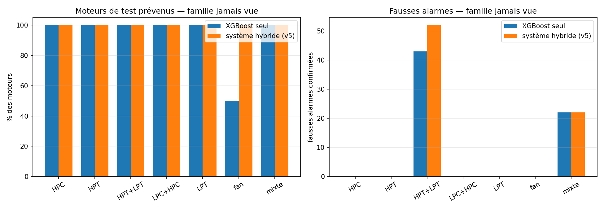

> **How to read this figure** (two panels, same X-axis)
>
> - **X-axis (both panels):** the failure family removed from training, so it is "never seen" by the models.
> - **Left panel, Y-axis:** percentage of test engines of that family that were warned (_"% des moteurs"_ = "% of engines"). **Higher is better.** Title: _"Moteurs de test prévenus — famille jamais vue"_ = "Test engines warned — never-seen family".
> - **Right panel, Y-axis:** number of confirmed false alarms (_"fausses alarmes confirmées"_). **Lower is better.** Title: _"Fausses alarmes — famille jamais vue"_ = "False alarms — never-seen family".
> - **Bars:** blue = XGBoost alone (_"XGBoost seul"_), orange = hybrid system v5 (_"système hybride (v5)"_). _mixte_ = mixed (multi-component) failures.

- On known failures, the hybrid matches XGBoost; on a never-seen failure, it warns **every** engine.
- MLflow registry: `aeroguard-alerte@champion` (XGBoost) and `aeroguard-anomalie@champion` (centered autoencoder) work together.
- **Limitation**: on some unknown fleets (HPT+LPT), both guards produce false alarms; a few reference flights from the new fleet would reduce them.
- Rejected attempts (documented): convolutional autoencoder on raw signals (7.5 flights of lead time) and "digital twin" (20.2 flights): physical features remain better on this data.

## 🧪 v6 — GANs and rare cases: generating synthetic data, and knowing when not to

**Question:** when a failure family is rare, can **synthetic** flights (GAN, SMOTE) help XGBoost?

**Approach (6 lessons):**

1. **Measure before building**: worn flights are not rare (70.5% of train); the real rarity is at the family level (fan, HPC, LPC+HPC: 5 engines each).
2. **Tabular GAN** (Keras, `tf.GradientTape` loop) trained on the 340 worn "fan" flights: stable training, close to equilibrium.
3. **Mode collapse** triggered and detected (1-dimensional noise: spacing between fake flights divided by 200), remedies tested (label smoothing, slowed-down expert).
4. **Full evaluation of the fake flights** on 4 pillars: fidelity (KS, IQR), realism (classifier), memorization (DCR), utility (TSTR).
5. **GAN versus SMOTE** with cross-validation by engine (GAN retrained in each fold to avoid any leakage).
6. **Final test** opened only once, decision made with the MLflow registry promotion rule.

**What the evaluation of the fake flights reveals (6.4):**

| Candidate                | Median KS ↓ | Can a classifier tell them apart? (AUC, 0.5 = no) | Copies the train set?   | Utility (TSTR PR-AUC) |
| ------------------------ | ----------- | ------------------------------------------------- | ----------------------- | --------------------- |
| Real flights (reference) | —           | —                                                 | —                       | **0.985**             |
| GAN                      | **0.147**   | **1.000** (yes, always)                           | no (0%)                 | 0.931                 |
| Gaussian                 | 0.191       | 0.423                                             | no                      | 0.966                 |
| Noisy copies (trap)      | 0.053       | 0.408                                             | **yes (100% detected)** | 0.980                 |

The GAN reproduces each feature well, but it **breaks physics** (negative standard deviations), and a simple classifier spots 100% of its fake flights.

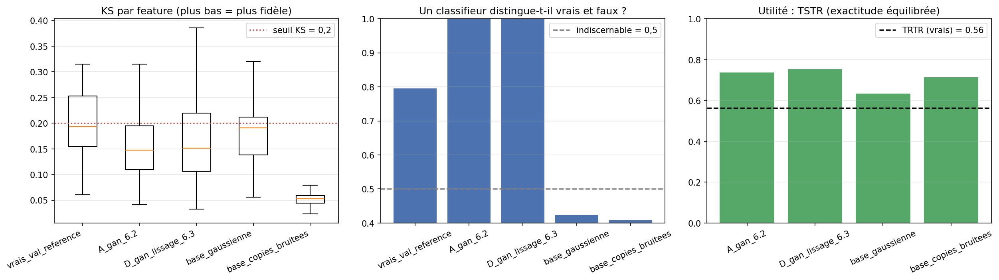

> **How to read this figure** (three panels)
>
> - **X-axis (all panels):** the candidates. _vrais_val_reference_ = real validation flights (reference), _A_gan_6.2_ = GAN from lesson 6.2, _D_gan_lissage_6.3_ = GAN with label smoothing from lesson 6.3, _base_gaussienne_ = Gaussian baseline, _base_copies_bruitees_ = noisy-copies baseline (the trap).
> - **Left panel, Y-axis:** KS distance per feature. Each box shows the spread of the KS values over all the features. **Lower = more faithful.** The red dotted line is the KS threshold of 0.2 (_"seuil KS = 0,2"_). Title: _"KS par feature (plus bas = plus fidèle)"_ = "KS per feature (lower = more faithful)".
> - **Middle panel, Y-axis:** AUC of a classifier trying to separate real from fake flights. The gray dashed line at **0.5 = indistinguishable** (_"indiscernable"_); **1.0 = always detected as fake**. Title: _"Un classifieur distingue-t-il vrais et faux ?"_ = "Can a classifier tell real from fake?".
> - **Right panel, Y-axis:** utility = balanced accuracy of a model trained on fake flights and tested on real ones (TSTR, _"exactitude équilibrée"_). The black dashed line is the same model trained on real flights (TRTR). Title: _"Utilité : TSTR (exactitude équilibrée)"_ = "Utility: TSTR (balanced accuracy)".

**GAN versus SMOTE (6.5, cross-validation, 6 folds):** with no augmentation, XGBoost already has a fan PR-AUC of 0.978 and detects **100%** of critical fan flights (ceiling effect). Raw GAN −0.0002, clipped GAN +0.0005, Gaussian −0.0011, SMOTE +0.0017: no useful gain in practice.

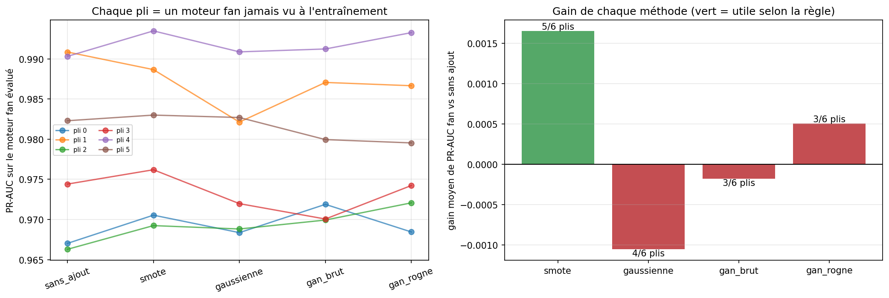

> **How to read this figure** (two panels)
>
> - **X-axis (both panels):** the augmentation methods. _sans_ajout_ = no augmentation (reference), _smote_ = SMOTE, _gaussienne_ = Gaussian, _gan_brut_ = raw GAN, _gan_rogne_ = clipped GAN.
> - **Left panel, Y-axis:** PR-AUC on the evaluated fan engine (_"PR-AUC sur le moteur fan évalué"_). Each colored line is one fold (_"pli"_), and each fold holds out one fan engine never seen in training. Title: _"Chaque pli = un moteur fan jamais vu à l'entraînement"_ = "Each fold = one fan engine never seen in training".
> - **Right panel, Y-axis:** mean gain in fan PR-AUC compared with no augmentation (_"gain moyen de PR-AUC fan vs sans ajout"_). The label above each bar gives the number of folds won out of 6 (_"plis"_ = folds). **Green = useful according to the rule, red = not useful.** Title: _"Gain de chaque méthode (vert = utile selon la règle)"_.

**Final test (39 engines, opened only once):**

| Model                  | Macro F1 | Fan PR-AUC | Engines detected | False alarms |
| ---------------------- | -------- | ---------- | ---------------- | ------------ |
| **XGBoost (champion)** | 0.851    | 0.975      | 39/39            | 37           |
| XGBoost + SMOTE        | 0.854    | 0.975      | 39/39            | 32           |

F1 gap not proven (95% CI [−0.002; +0.015]), fan gain of +0.0005 below the required minimum (+0.01): **the champion stays in place** (`aeroguard-alerte@champion`).

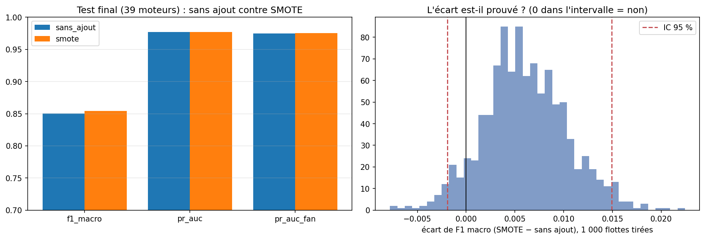

> **How to read this figure** (two panels)
>
> - **Left panel:** the **X-axis** shows three metrics (macro F1, overall PR-AUC, fan PR-AUC); the **Y-axis** is the score. The axis starts at **0.7, not 0**, to make small gaps visible. Bars: blue = _sans_ajout_ (champion, no augmentation), orange = _smote_. Title: _"Test final (39 moteurs) : sans ajout contre SMOTE"_ = "Final test (39 engines): no augmentation versus SMOTE".
> - **Right panel:** the **X-axis** is the macro F1 gap (SMOTE − no augmentation) over 1,000 randomly drawn fleets (_"écart de F1 macro … 1 000 flottes tirées"_); the **Y-axis** is the number of draws. The black line is 0 and the red dashed lines bound the 95% CI (_"IC 95 %"_). **If 0 lies between the red lines, the gap is not proven.** Title: _"L'écart est-il prouvé ? (0 dans l'intervalle = non)"_ = "Is the gap proven? (0 inside the interval = no)".

**Which model for which situation?**

- **Known, well-represented failure** → XGBoost (supervised): the most accurate and the simplest.
- **Never-seen failure** → autoencoder trained on normal data, with a per-engine baseline.
- **In production** → the v5 hybrid system (XGBoost OR autoencoder).
- **Known but very rare failure, and the supervised model fails** → SMOTE first, then a GAN only with a full evaluation (fidelity, realism, memorization, utility).
- **Always** → a decision rule fixed before looking, a minimum effect size, and a test opened only once.

**Limitations:** only one rare family studied (fan); simple tabular GAN (no WGAN-GP or conditional GAN); the "rare" families still have 5 to 6 engines, which does not allow conclusions for a family with 1 or 2 engines.

## 🔍 Explainability: why the model raises an alert (SHAP)

Each XGBoost decision is broken down sensor by sensor with SHAP, computed directly on GPU (×11.7 faster than on CPU).

**What triggers an alert** — the temperatures around the turbines (T50, T48) during climb dominate, exactly the physical signature of a worn turbine:

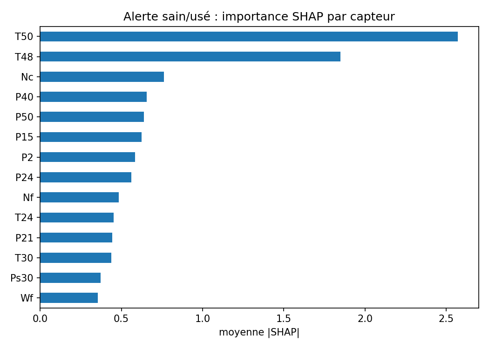

> **How to read this figure** (horizontal bars)
>
> - **Y-axis:** the 14 sensors, the most important at the top.
> - **X-axis:** mean absolute SHAP value, summed over the 9 features of each sensor (_"moyenne |SHAP| (somme des 9 features du capteur)"_). **A longer bar means more influence on the alert.**
> - **Title:** _"Alerte sain/usé : importance SHAP par capteur"_ = "Healthy/worn alert: SHAP importance per sensor".

**Direction of the effect** — each dot is one flight; a high T48/T50 temperature (in red) pushes toward "worn":

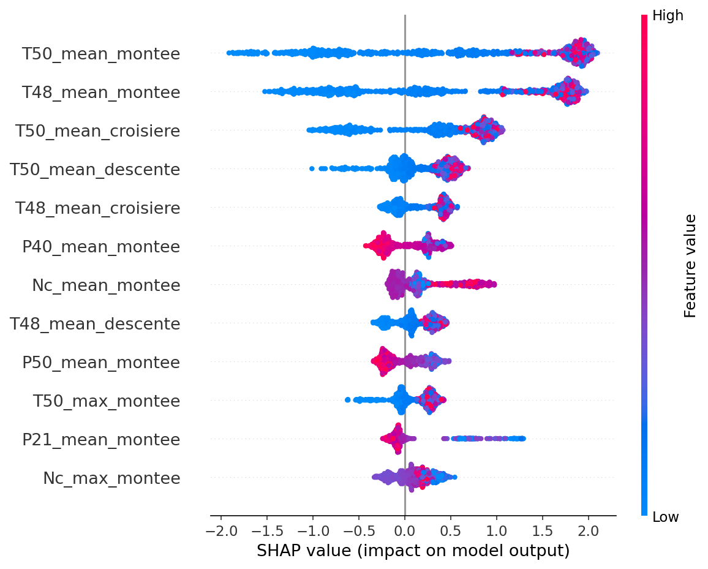

> **How to read this figure** (SHAP summary plot)
>
> - **Y-axis:** the 12 most important features (sensor + statistic + flight phase, e.g. `T50_mean_montee` = mean T50 during climb).
> - **X-axis:** SHAP value = impact on the model output. **Right of 0 pushes toward "worn", left of 0 pushes toward "healthy".**
> - **Dots and color:** each dot is one flight; **red = high value of the feature, blue = low value.**
> - **Title:** _"Chaque point = un vol ; rouge = valeur haute de la feature"_ = "Each dot = one flight; red = high feature value".

**Example of an explained alert** — engine DS01_1, flight 37, 63 flights before failure (probability 91%):
alert because of T50 during climb (+0.77), T50 during cruise (+0.47) and T48 during climb (+0.35).

**Component diagnosis** — share of each sensor in the decision, for each failure family:

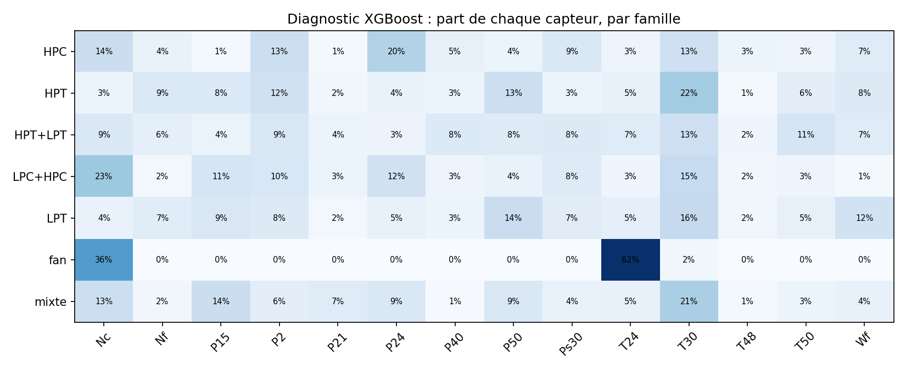

> **How to read this figure** (heatmap)
>
> - **X-axis (columns):** the 14 sensors.
> - **Y-axis (rows):** the failure families the diagnosis model can predict.
> - **Cell value and color:** the share (%) of each sensor in the XGBoost decision for that family. **Each row adds up to 100%; darker blue = larger share.**
> - **Title:** _"Diagnostic XGBoost : part de chaque capteur dans la décision, par famille"_ = "XGBoost diagnosis: share of each sensor in the decision, per family".

> **Limitation found thanks to SHAP:** each failure family comes from a single NASA file, and part of the diagnosis relies on P2 (inlet pressure), a sensor that reveals the file rather than the failure. The diagnosis remains mostly physical (P24, T30, Nc, T50), but its scores are probably optimistic for a new fleet. Details in [`docs/baselines.md`](docs/baselines.md).

## 🚀 v7 — Full application: decision engine, API, dashboard, deployment and monitoring

Version 7 turns the models into a service that a maintenance team can use: every new flight is sent to an API, which answers with a clear recommendation.

**Live API:** <https://aeroguard-api-75tq.onrender.com> (`/health`, `/docs`)

### Decision engine: from probabilities to actions

The hybrid system (XGBoost OR autoencoder) is turned into three levels:

| Level          | Meaning                                    | Example message                                                    |
| -------------- | ------------------------------------------ | ------------------------------------------------------------------ |
| `OK`           | nothing to report                          | —                                                                  |
| `A_SURVEILLER` | watch this engine (early or isolated sign) | —                                                                  |
| `URGENT`       | plan an inspection                         | "Wear confirmed by both models: priority intervention." (T48, T50) |

Replay of the **39 test engines**, flight by flight (2,938 flights):

- **39 / 39** engines reached `URGENT` before failure, with a median lead time of **39 flights**;
- **18** healthy flights classified `URGENT` (false emergencies);
- each recommendation lists the sensors in cause (worst-reconstructed by the autoencoder) to guide the inspection.

**Fleet simulation through the API** (`scripts/simuler_flotte.py`): 39 engines followed to the end, **39 failures avoided** (sent to the workshop), **0 in-service failures**, median alert lead time of 39 flights, 35.9 flights left on average when the engine reaches the workshop.

### FastAPI service

| Endpoint                                  | Role                                             |
| ----------------------------------------- | ------------------------------------------------ |
| `POST /flotte/vols`                       | send one flight, get the decision for its engine |
| `GET /flotte/moteurs`                     | list the engines being followed                  |
| `GET /flotte/moteurs/{moteur}`            | current state of one engine                      |
| `GET /flotte/moteurs/{moteur}/historique` | decision history of one engine                   |
| `DELETE /flotte/moteurs/{moteur}`         | forget an engine (after a workshop visit)        |
| `GET /health`                             | version, inference mode, loaded models           |
| `GET /monitoring/derive`                  | data-drift report (PSI) on recent flights        |

Three interchangeable inference modes, chosen with `AEROGUARD_INFERENCE`:

| Mode     | Engine                                  | Parity with the notebook (76 flights of DS02_14) |
| -------- | --------------------------------------- | ------------------------------------------------ |
| `onnx`   | ONNX Runtime + XGBoost (Docker default) | 76 / 76 levels, max gap 1.11e-16                 |
| `triton` | NVIDIA Triton Inference Server          | 76 / 76 levels, max gap 2.98e-07 (float32)       |
| `local`  | Keras + XGBoost in the API process      | reference                                        |

### Load testing

480 requests per run, 0 errors, per-engine locks (two engines never wait for each other):

| Mode   | Concurrent clients | Throughput (req/s) | p50 (ms) | p95 (ms) | p99 (ms) |
| ------ | ------------------ | ------------------ | -------- | -------- | -------- |
| local  | 1                  | 8.5                | 115.2    | 251.4    | 326.9    |
| local  | 4                  | 14.2               | 311.8    | 482.5    | 596.5    |
| local  | 16                 | 14.8               | 1152.3   | 1809.8   | 2838.4   |
| triton | 1                  | 43.5               | 9.0      | 83.8     | 130.6    |
| triton | 4                  | 64.4               | 48.2     | 139.8    | 181.4    |
| triton | 16                 | 79.5               | 174.8    | 398.2    | 494.2    |

- Moving inference out of the Python process (Triton) gives **×5 to ×5.4 more throughput** (43.5 vs 8.5 req/s with 1 client, 79.5 vs 14.8 with 16 clients).
- In `onnx` mode, inside the Docker image on Linux, the median latency is about **5 ms** per request: measure in the target environment, not only on the development machine.

### Dashboard (Streamlit)

- **Fleet** page: the level of every engine and its history, with the sensors in cause.
- **System Health** page: API version, inference mode, loaded models and the latest drift report.

### Delivery: CI/CD

Pushing a `v*` tag starts `cd.yml`:

1. **CI**: the same pipeline as every pull request (Ruff, 351 tests, coverage).
2. **Publish**: Docker image built and scanned with Trivy. A smoke test runs before the push, then the image goes to GitHub Container Registry with semantic-version tags (`latest` only for final releases).
3. **Deploy**: Render deploy hook with the exact image, then a public smoke test checks that `/health` returns the expected version.
4. **Release**: GitHub release created from the tag.

Models are not stored in the image or in Git: the API downloads them at startup from a private Hugging Face repository, with a read-only token passed as an environment variable.

### Monitoring

- **Structured JSON logs**: one line per request (`aeroguard.http`, with `duration_ms`) and per decision (`aeroguard.decision`). Every response carries an `X-Response-Time-ms` header.
- **Data drift (PSI)**: recent flights are compared with the training data, feature by feature, on the deciles of the reference. Thresholds: 0.10 = moderate, 0.25 = major. The report needs at least 50 flights from at least 5 engines.
- Drift experiment on the test set:
  - data as it is → `moderate` (2 features slightly above 0.10);
  - T48 biased by +0.1 standard deviation → `major` (PSI 0.496);
  - dead T48 sensor → `major` (PSI 8.281).
- **Weekly drift workflow** (GitHub Actions, cron + manual run): it computes the report and opens an issue when drift is major.

### Known limitations

- **Engine history lives in memory.** It is lost when the service restarts, and the free Render plan puts the service to sleep after inactivity (the first request after a pause is slow). Next step: a persistent store behind the `DepotHistorique` interface.
- **Drift needs a fleet, not one engine.** Replaying a single engine (76 flights of DS02_14) shows `major` drift on 125 features, because one engine does not look like the whole fleet. That is why the report requires 5 engines.
- **PSI looks at each feature alone**, on fixed deciles. A change in scale that keeps values inside the same deciles, or a change in the relationship between two sensors, can stay under the thresholds.
- **No issue deduplication.** The weekly workflow opens a new issue each time major drift is found.
- **Triton is local only.** The free hosting is CPU-only with 512 MB of RAM, so the public API runs in `onnx` mode.

## Project structure

```
data/            raw and processed data (not versioned)
notebooks/       exploration and analyses (one notebook per step)
src/aeroguard/   reusable code (Python package)
tests/           automated tests (pytest)
results/         charts and results
docs/            documentation, baselines and logbook
```

| Module                 | Role                                                          |
| ---------------------- | ------------------------------------------------------------- |
| `simulation.py`        | Simulated fleet (v0)                                          |
| `detection.py`         | z-score baseline and alarm confirmation                       |
| `data.py`              | Reading N-CMAPSS HDF5 files, labels                           |
| `normalisation.py`     | Healthy-engine model and residuals                            |
| `features.py`          | Flight phases and 126 features per flight                     |
| `decoupage.py`         | Train / val / test split by engine, with no leakage           |
| `pipeline.py`          | Full pipeline for one file                                    |
| `outils.py`            | Timing                                                        |
| `donnees_ml.py`        | Preparing X / y (alert and diagnosis), class weights          |
| `evaluation.py`        | Decision threshold, metrics, leaderboard                      |
| `explication.py`       | Readable feature names, importances, SHAP explanations        |
| `modeles.py`           | XGBoost (GPU), optimal threshold, Optuna search space         |
| `anomalies.py`         | Unsupervised detection (score, percentile threshold)          |
| `metier.py`            | Alert lead time, false alarms, per-engine diagnosis           |
| `decision.py`          | Decision engine: OK / A_SURVEILLER / URGENT, sensors in cause |
| `service.py`           | Decision service (local, ONNX or Triton inference)            |
| `depot.py`             | Engine history storage interface (in-memory store)            |
| `api.py`               | FastAPI app, middleware, `/health`                            |
| `routes_flotte.py`     | Fleet endpoints (`/flotte/...`)                               |
| `routes_monitoring.py` | Drift endpoint (`/monitoring/derive`)                         |
| `client_triton.py`     | Client for NVIDIA Triton                                      |
| `derive.py`            | PSI drift report                                              |
| `journalisation.py`    | Structured JSON logs                                          |
| `modeles_hf.py`        | Model download from Hugging Face                              |
| `sante_systeme.py`     | System health data for the dashboard                          |
| `charge.py`            | Load-test helpers (latency percentiles)                       |

## Installation (Windows)

```bash
python -m venv .venv
.venv\Scripts\Activate.ps1
pip install -r requirements.txt
pip install -e .
```

## Usage

```bash
python -m aeroguard.simulation    # generate a simulated fleet
pytest -v                         # run the tests

# API (ONNX mode, models in local/models)
$env:AEROGUARD_MODELES="local/models"
$env:AEROGUARD_INFERENCE="onnx"
uvicorn aeroguard.api:app --port 8005

# Full stack: API + Triton + MLflow
docker compose up -d --build
```

## With Docker

```bash
docker build -t aeroguard:v0 .
docker run --rm aeroguard:v0              # simulator
docker run --rm aeroguard:v0 pytest -v    # tests
```

## Technologies

Python · NumPy · pandas · Matplotlib · scikit-learn · XGBoost (GPU) · Optuna · SHAP · NVIDIA RAPIDS (cuDF) · h5py · TensorFlow / Keras · MLflow · FastAPI · ONNX Runtime · NVIDIA Triton · Streamlit · pytest · Ruff · pre-commit · Docker · GitHub Actions · GHCR · Trivy · Render · Hugging Face Hub · Codecov · Dependabot

## Roadmap

- [x] **v0 — Foundations**: environment, z-score detection, simulator, tests, Docker, CI
- [x] **v1 — NASA N-CMAPSS data**: 9 files, 99 engines, 7,473 flights, 126 features, leak-free split
- [x] **v2 — Baselines and metrics**: 6 models, macro F1, per-engine business metrics
- [x] **v3 — XGBoost on GPU**: alert (39/39 engines, 40 flights of lead time), component diagnosis (37/39), Optuna, SHAP, unknown-failure test
- [x] **v4 — Deep learning**: dense network and 1D CNN (TensorFlow), MLflow tracking, final bootstrap comparison: XGBoost stays on top
- [x] **v5 — Autoencoder and hybrid system**: detection of never-seen failures (fan: 4/4 test engines versus 2/4 for XGBoost alone), per-engine baseline, per-sensor diagnosis
- [x] **v6 — GANs and rare cases**: tabular GAN, mode-collapse detection, evaluation of synthetic data (fidelity, realism, memorization, TSTR), GAN versus SMOTE; no useful gain, the XGBoost champion stays in place
- [ ] v7 — Full application (Triton, API, dashboard)
